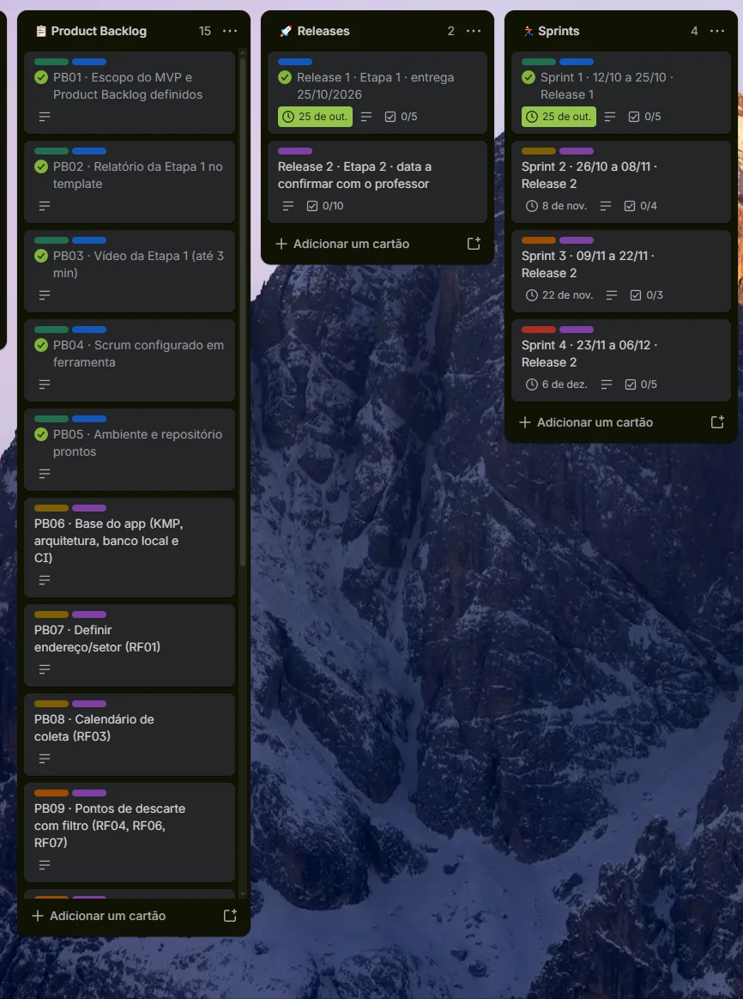
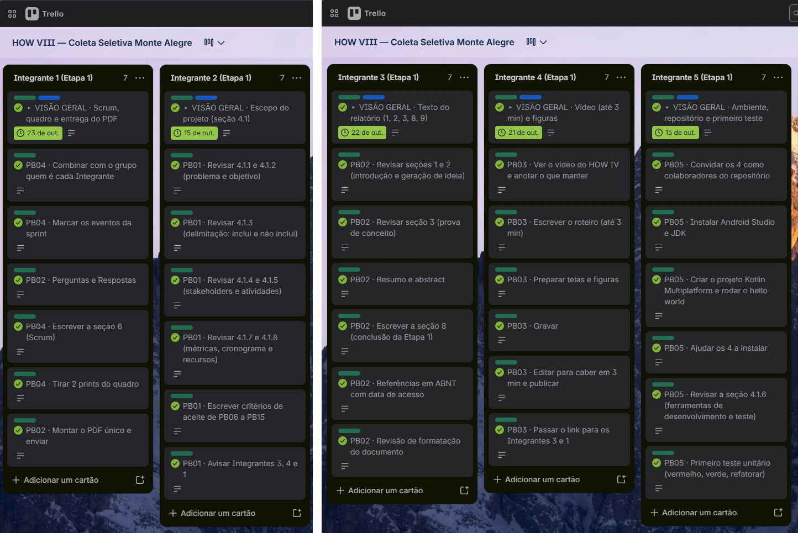

<!-- Dono: Integrante 1 (Scrum Master). Seção 6. Mantenha igual ao quadro do Trello e a docs/BACKLOG.md. Etapa 2: acrescente aqui as sprints 2 a 4. -->

## SCRUM Configurado

O Scrum foi adotado por sua natureza iterativa e incremental, que permite adaptação rápida e alinhamento constante com os stakeholders. O projeto é dividido em sprints de duas semanas e foi configurado na ferramenta online Trello, no quadro "HOW VIII — Coleta Seletiva Monte Alegre", com listas para product backlog, releases e sprints e colunas por integrante, divididas entre a Etapa 1 e a Etapa 2.

**Papéis do time Scrum**

| Integrante | Papel Scrum | Responsabilidades |
|---|---|---|
| Integrante 1 | Scrum Master | Facilita os eventos, remove impedimentos, configura o Trello, monta e envia o PDF |
| Integrante 2 | Product Owner | Define o escopo, prioriza o product backlog e escreve os critérios de aceite |
| Integrante 3 | Redator | Produz a documentação, cuida da escrita, do formato ABNT e do resumo |
| Integrante 4 | Editor | Define o objetivo, estrutura o roteiro e edita o vídeo de até 3 minutos |
| Integrante 5 | Time de Desenvolvimento (técnico) | Mantém o repositório, o ambiente e a integração contínua; implementa e testa |

> Tabela 3 – Papéis do time Scrum. Fonte: elaborado pelos autores (2026).

**Eventos**

| Evento | Frequência | Objetivo |
|---|---|---|
| Sprint | 2 semanas (duração fixa) | Entregar um incremento utilizável |
| Sprint Planning | Primeiro dia da sprint, até 1 hora | Definir o objetivo e selecionar os itens do product backlog |
| Daily Scrum | Diária, assíncrona (3 linhas) | O que fez, o que fará e impedimentos |
| Sprint Review e Retrospectiva | Último dia da sprint, até 1 hora no total | Apresentar o incremento, receber feedback e melhorar o processo |

> Tabela 4 – Eventos do Scrum. Fonte: elaborado pelos autores (2026).

**Product backlog**

| ID | Item do product backlog (user story) | Release | Sprint | Pontos |
|---|---|---|---|---|
| PB01 | Como Product Owner, quero o escopo do MVP e o product backlog priorizado | 1 | 1 | 5 |
| PB02 | Como time, quero o relatório da Etapa 1 completo no template | 1 | 1 | 13 |
| PB03 | Como professor, quero um vídeo de até 3 minutos da Etapa 1 | 1 | 1 | 8 |
| PB04 | Como time, quero product backlog, releases e sprints configurados no Trello, com prints | 1 | 1 | 5 |
| PB05 | Como time de desenvolvimento, quero o ambiente e o repositório prontos em todos | 1 | 1 | 5 |
| PB06 | Como time, quero a base do app (arquitetura, banco local com municípios e setores como dados, e integração contínua) | 2 | 2 | 8 |
| PB07 | Como morador, quero escolher meu município e setor de coleta | 2 | 2 | 3 |
| PB08 | Como morador, quero ver o calendário de coleta do meu município e setor | 2 | 2 | 5 |
| PB09 | Como morador, quero ver os pontos de descarte do meu município e filtrar por material | 2 | 3 | 8 |
| PB10 | Como morador, quero ver onde fica o ponto de descarte | 2 | 3 | 3 |
| PB11 | Como morador, quero buscar no guia de separação, mesmo sem internet | 2 | 4 | 8 |
| PB12 | Como morador, quero ser lembrado na véspera da coleta | 2 | 4 | 5 |
| PB16 | Como morador, quero registrar meus descartes e acumular pontos, com saldo e histórico | 2 | 3 | 8 |
| PB17 | Como morador, quero ver dicas de reciclagem | 2 | 4 | 2 |
| PB13 | Como time, quero testes escritos antes do código em todas as funcionalidades | 2 | 2 a 4 | 13 |
| PB14 | Como time, quero validar o app com roteiro de teste e usuários | 2 | 4 | 5 |
| PB15 | Como time, quero a Etapa 2 documentada e o vídeo de até 3 minutos | 2 | 4 | 8 |

> Tabela 5 – Product backlog. Fonte: elaborado pelos autores (2026).

**Releases**

A Release 1 corresponde à Etapa 1 (relatório, vídeo e Scrum configurado, itens PB01 a PB05). A Release 2 corresponde à Etapa 2 (aplicativo testado, validação, relatório e vídeo, itens PB06 a PB17).

**Sprint 1**

O objetivo da Sprint 1 (12/10 a 25/10) é concluir e validar o relatório, o vídeo e a base técnica necessários para a entrega da Etapa 1. As atividades da Etapa 2 serão acrescentadas nas Sprints 2 a 4.

| Item (PB) | Tarefa | Responsável | Status |
|---|---|---|---|
| PB01 | Revisar o escopo (seção 4.1) e escrever os critérios de aceite | Integrante 2 (Product Owner) | Concluído |
| PB02 | Redigir as seções 1 a 3, 8 e 9 e revisar a formatação | Integrante 3 (Redator) | Concluído |
| PB02 | Montar o PDF único e enviar | Integrante 1 (Scrum Master) | Concluído |
| PB03 | Roteiro, gravação, edição e publicação do vídeo | Integrante 4 (Editor) | Concluído |
| PB04 | Configurar o quadro no Trello, escrever a seção 6 e tirar os prints | Integrante 1 (Scrum Master) | Concluído |
| PB05 | Ambiente, repositório e primeiro teste (TDD) | Integrante 5 (Time de Desenvolvimento) | Concluído |

> Tabela 6 – Sprint backlog da Sprint 1. Fonte: elaborado pelos autores (2026).

A Figura 1 mostra as listas Product Backlog (PB01 a PB15), Releases e Sprints do quadro, com etiquetas de release e de sprint. A Figura 2 mostra o sprint backlog da Sprint 1, dividido em uma coluna por integrante para a Etapa 1.

> Figura 1 – Quadro do Trello: Product Backlog, Releases e Sprints. Fonte: elaborado pelos autores (2026).

> Figura 2 – Quadro do Trello: sprint backlog da Etapa 1, por integrante. Fonte: elaborado pelos autores (2026).
